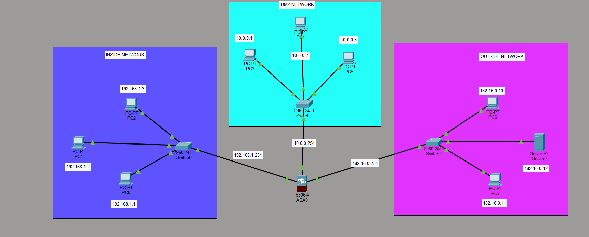

# Cisco ASA 5506-X Firewall Lab (Inside / DMZ / Outside)

A Cisco Packet Tracer lab that uses a **Cisco ASA 5506-X** firewall to separate three security zones: an **Inside** LAN, a **DMZ**, and an **Outside** network. It demonstrates security levels, zone-based traffic control, NAT, and ACLs.



## Topology Overview

| Zone | Subnet | Switch | ASA Interface IP (Gateway) | Suggested Security Level |
|------|--------|--------|----------------------------|--------------------------|
| INSIDE-NETWORK | 192.168.1.0/24 | Switch0 (2960-24TT) | 192.168.1.254 | 100 |
| DMZ-NETWORK | 10.0.0.0/24 | Switch1 (2960-24TT) | 10.0.0.254 | 50 |
| OUTSIDE-NETWORK | 182.16.0.0/24 | Switch2 (2960-24TT) | 182.16.0.254 | 0 |

## Devices and IP Addressing

### Inside Network (192.168.1.0/24)

| Device | Type | IP Address | Gateway |
|--------|------|-----------|---------|
| PC0 | PC-PT | 192.168.1.1 | 192.168.1.254 |
| PC1 | PC-PT | 192.168.1.2 | 192.168.1.254 |
| PC2 | PC-PT | 192.168.1.3 | 192.168.1.254 |

### DMZ Network (10.0.0.0/24)

| Device | Type | IP Address | Gateway |
|--------|------|-----------|---------|
| PC3 | PC-PT | 10.0.0.1 | 10.0.0.254 |
| PC4 | PC-PT | 10.0.0.2 | 10.0.0.254 |
| PC5 | PC-PT | 10.0.0.3 | 10.0.0.254 |

### Outside Network (182.16.0.0/24)

| Device | Type | IP Address | Gateway |
|--------|------|-----------|---------|
| PC6 | PC-PT | 182.16.0.10 | 182.16.0.254 |
| PC7 | PC-PT | 182.16.0.11 | 182.16.0.254 |
| Server0 | Server-PT | 182.16.0.12 | 182.16.0.254 |

### Network Equipment

| Device | Model | Role |
|--------|-------|------|
| ASA0 | Cisco ASA 5506-X | Firewall connecting all three zones |
| Switch0 | Catalyst 2960-24TT | Inside LAN switch |
| Switch1 | Catalyst 2960-24TT | DMZ switch |
| Switch2 | Catalyst 2960-24TT | Outside switch |

## Traffic Policy (Default ASA Behavior)

The ASA allows traffic from a higher security level to a lower one by default, and blocks the reverse unless an ACL permits it.

| Source → Destination | Default Result | Notes |
|----------------------|----------------|-------|
| Inside → DMZ | Allowed | 100 → 50 |
| Inside → Outside | Allowed | 100 → 0 (NAT recommended) |
| DMZ → Outside | Allowed | 50 → 0 |
| DMZ → Inside | Blocked | Needs an ACL to permit |
| Outside → Inside | Blocked | Needs an ACL to permit |
| Outside → DMZ | Blocked | Needs an ACL to permit |

## Sample ASA Configuration

> This is a starting point. Interface names may differ in your Packet Tracer version. Check with `show interface ip brief`.

```text
enable
configure terminal
hostname ASA0

! ---- Interfaces ----
interface GigabitEthernet1/1
 nameif inside
 security-level 100
 ip address 192.168.1.254 255.255.255.0
 no shutdown

interface GigabitEthernet1/2
 nameif dmz
 security-level 50
 ip address 10.0.0.254 255.255.255.0
 no shutdown

interface GigabitEthernet1/3
 nameif outside
 security-level 0
 ip address 182.16.0.254 255.255.255.0
 no shutdown

! ---- NAT: Inside -> Outside (PAT) ----
object network INSIDE-NET
 subnet 192.168.1.0 255.255.255.0
 nat (inside,outside) dynamic interface

! ---- Inspect ICMP so return traffic is allowed ----
policy-map global_policy
 class inspection_default
  inspect icmp

! ---- ACL: allow Outside to ping the DMZ ----
access-list OUTSIDE-IN extended permit icmp any 10.0.0.0 255.255.255.0
access-group OUTSIDE-IN in interface outside
```

## How to Run

1. Open the `.pkt` file in **Cisco Packet Tracer** (7.x or later, with ASA 5506-X support).
2. Make sure every PC and the server has the IP address and default gateway listed above.
3. Open the ASA0 CLI and apply the configuration above.
4. Run the tests below.

## Test Plan

| # | Test | Expected Result |
|---|------|-----------------|
| 1 | PC0 → ping 10.0.0.1 (Inside → DMZ) | Success |
| 2 | PC0 → ping 182.16.0.12 (Inside → Outside) | Success |
| 3 | PC3 → ping 182.16.0.10 (DMZ → Outside) | Success |
| 4 | PC3 → ping 192.168.1.1 (DMZ → Inside) | Fails (blocked) |
| 5 | PC6 → ping 192.168.1.1 (Outside → Inside) | Fails (blocked) |
| 6 | PC6 → ping 10.0.0.1 (Outside → DMZ) | Success only with the ACL applied |

Useful ASA commands for verification:

```text
show interface ip brief
show nameif
show nat
show access-list
show xlate
show conn
```

## Learning Objectives

- Understand ASA security levels and zone separation
- Configure ASA interfaces with `nameif` and `security-level`
- Use NAT/PAT for Inside-to-Outside access
- Write ACLs to selectively permit traffic into the DMZ
- Verify firewall behavior with ping and ASA show commands

## Possible Extensions

- Host a web or FTP server in the DMZ and publish it with static NAT
- Add DHCP on the Inside interface
- Restrict DMZ → Inside traffic with specific ACL rules
- Add logging (`logging buffered`) and review denied packets

## License

Provided for educational use.
